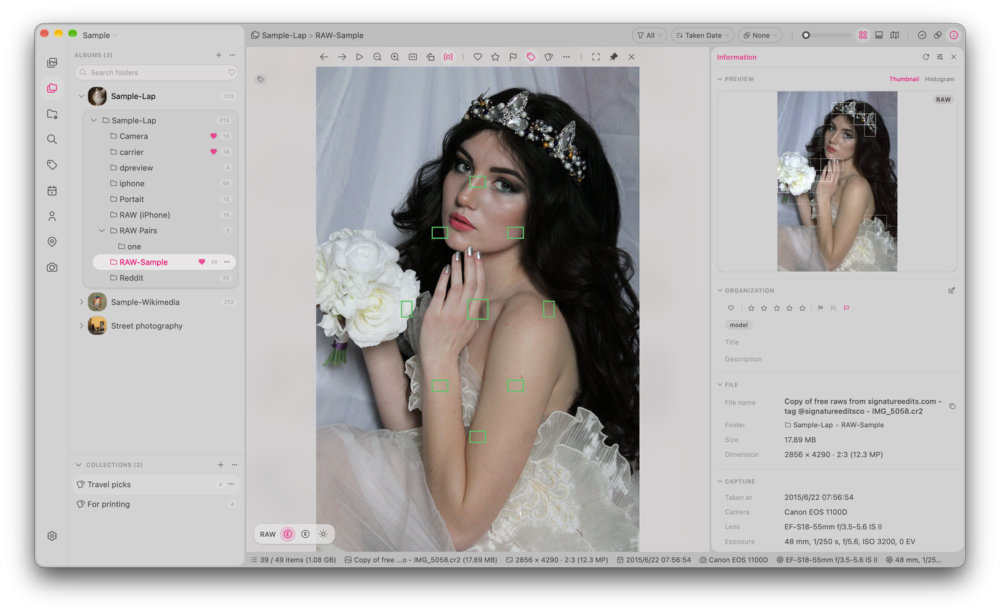

<div align="center">
  
  <h1>Lap - Gestionnaire de photos privées locales</h1>
  <h3>Gestionnaire de photos de bureau open source pour macOS, Windows et Linux.</h3>
  <p>
    <a href="https://trendshift.io/repositories/24497?utm_source=repository-badge&amp;utm_medium=badge&amp;utm_campaign=badge-repository-24497" target="_blank" rel="noopener noreferrer"></a>
  </p>
  <p>
    <a href="https://github.com/julyx10/lap/releases"></a>
    <a href="https://github.com/julyx10/lap/releases"></a>
    <a href="https://github.com/julyx10/lap/stargazers"></a>
  </p>
</div>

[English](../README.md) | [Česky](README.cs.md) | [Deutsch](README.de.md) | [Español](README.es.md) | Français | [Italiano](README.it.md) | [Magyar](README.hu.md) | [Nederlands](README.nl.md) | [Polski](README.pl.md) | [Português](README.pt.md) | [Русский](README.ru.md) | [Українська](README.uk.md) | [Tiếng Việt](README.vi.md) | [中文简体](README.zh-CN.md) | [中文繁體](README.zh-TW.md) | [日本語](README.ja.md) | [한국어](README.ko.md)

Lap est un gestionnaire de photos open source et local-first conçu pour parcourir les albums familiaux, retrouver rapidement d'anciennes photos et gérer de grandes bibliothèques multimédias personnelles hors ligne.
Sans importation obligatoire, abonnement ni téléversement. Ouvrez vos dossiers directement dans Lap. Les fichiers conservent leur emplacement et leur format. Enregistrez-les dans des fichiers annexes XMP pour les utiliser dans les applications compatibles. La recherche par IA s’exécute sur votre appareil.

<div align="center">
  <p><strong><a href="https://julyx10.github.io/lap/">SITE OFFICIEL</a> | <a href="https://julyx10.github.io/lap/demos/lap/index.html">DÉMO</a></strong></p>
</div>

## Télécharger Lap

Ouvrez la [page des dernières versions](https://github.com/julyx10/lap/releases/latest), puis téléchargez le fichier correspondant à votre système :

| Plateforme | Paquet | Remarque |
| :-- | :-- | :-- |
| **macOS (Apple Silicon / Intel)** | `_aarch64.dmg` / `_x64.dmg` | Notarié par Apple |
| **Windows 10/11 (x64 / ARM64)** | `_x64_en-US.msi` / `_arm64_en-US.msi` | Non signé. Choisissez **Conserver quand même** dans le navigateur ou **Informations complémentaires** → **Exécuter quand même** dans SmartScreen. |
| **Linux (x64 / ARM64)** | `_amd64.deb` / `_arm64.deb` | Pour les distributions basées sur Debian (Ubuntu, Debian, Linux Mint, etc.) |
| **Linux (x64 / ARM64)** | `_amd64.AppImage` / `_aarch64.AppImage` | Rendez le fichier exécutable, puis double-cliquez pour le lancer |

### macOS avec Homebrew

```bash
brew tap julyx10/lap
brew install --cask lap
```

## Captures d'écran

<p align="center">
  
  
  
  
</p>

## Pourquoi Lap

- **Gestion de la photothèque par dossiers.** Ouvrez vos dossiers directement dans Lap. Les fichiers conservent leur emplacement et leur format.
- **Recherche IA locale.** Décrivez une photo, trouvez des images similaires ou parcourez les visages. Tout est traité sur votre appareil.
- **Notes et mots-clés portables.** Enregistrez-les dans des fichiers annexes XMP pour les utiliser dans les applications compatibles.
- **Tri des photos.** Aperçu avec la barre d’espace, avance après notation, affichage des zones AF, comparaison à quatre panneaux et règles de conservation des doublons.
- **Pour les photothèques de plus de 100 000 photos et vidéos.** Un cœur natif en Rust assure la navigation, la recherche et l’analyse.
- **Gratuit et open source.** Sans abonnement ni compte, en 17 langues sur macOS, Windows et Linux.

## Fonctionnalités

- **Navigation flexible** par date, dossier, lieu, appareil, objectif, tags, notes et visages, avec tri et recherche.
- **Organisation par dossiers.** Photothèques multiples, import et export par glisser-déposer ou presse-papiers, renommage par lots et synchronisation, déplacement, copie et suppression en toute sécurité.
- **Recherche par IA locale** par texte, similarité visuelle, sujets et regroupement de visages, avec recherche multilingue optionnelle dans plus de 50 langues.
- **Importation des métadonnées et écriture XMP** · Lap lit les données EXIF, IPTC et XMP intégrées et les fichiers annexes (notes, mots-clés, favoris, états de tri, GPS et dates). Vous pouvez modifier les champs de texte et enregistrer les données d’organisation dans les fichiers XMP.
- **Albums intelligents.** Regroupement et tri personnalisés, filtres par nom de dossier et sélecteurs avec recherche.
- **Import organisé par date** dans des dossiers par jour, mois, année ou un dossier unique, en conservant les noms d’origine et en ignorant les doublons.
- **Collections et tags** pour organiser les fichiers sélectionnés par lot sans déplacer ni dupliquer les originaux. Arborescence de mots-clés avec glisser-déposer et compteurs par branche.
- **Nettoyage des doublons.** Règles par dossier, format, taille et date, espace récupérable et suppression par lots.
- **Outils de sélection et de comparaison.** Aperçu avec la barre d’espace, avance après notation, affichage des zones AF, comparaison à quatre panneaux et règles de conservation des doublons.
- **Édition intégrée** pour recadrer, redresser à un angle quelconque, pivoter, retourner, redimensionner et effectuer des ajustements de base.
- **Collage de photos** pour assembler les photos sélectionnées en grille, en mosaïque justifiée ou en pile de photos.
- **Apple Live Photos et Google Motion Photos** avec lecture animée et filtre commun dans les albums intelligents.
- **Paires RAW + JPEG/HEIC** affichées comme un seul élément, dont les fichiers liés restent ensemble lors des opérations. Vous pouvez supprimer un seul fichier d’une paire RAW ou les deux. Si un fichier reste, son fichier annexe XMP partagé est conservé.
- **Miniatures et aperçus RAW configurables** à partir du rendu RAW ou de l’aperçu intégré de l’appareil, avec luminosité réglable et affichage des paires RAW+JPEG.
- **Informations de fichier personnalisables.** Champs sélectionnables, détails chargés à la demande et zones AF dans la visionneuse.
- **Carte interactive** pour explorer les photos et vidéos géolocalisées, regroupées selon les filtres actifs.
- **Navigation hors ligne des albums** qui garde les albums sur un stockage déconnecté ou réseau visibles avec des miniatures en cache.
- **Fichiers uniquement en ligne.** Les fichiers OneDrive à la demande et les fichiers dématérialisés de macOS sont indexés et affichés sans téléchargement automatique.
- **Thèmes clair et sombre.** Peuvent suivre l’apparence du système.
- **Large compatibilité** avec plus de 60 formats image, RAW et vidéo. Documents Affinity (aperçu intégré).

## Métadonnées, collections et déplacement de fichiers

Lap travaille directement avec vos dossiers. La plupart des informations affichées sont lues dans les fichiers. Vous pouvez enregistrer vos données d’organisation dans des fichiers annexes XMP standard lisibles par d’autres applications photo.

Lap lit les métadonnées compatibles de Lightroom, digiKam, darktable et ACDSee. Les champs pris en charge varient selon l’application.

### Ce qui reste avec le fichier

- Vos photos et vidéos originales restent toujours des fichiers ordinaires dans leurs dossiers existants.
- Lors de l’indexation, Lap lit les données EXIF, IPTC et XMP intégrées, dont les informations de prise de vue et d’organisation. Activez **Paramètres → Métadonnées → Importer les métadonnées** pour importer les données d’organisation dans la base locale. Les modifications locales sont conservées.
- Les valeurs prises en charge dans les fichiers annexes XMP priment sur les valeurs intégrées, notamment le GPS et la date de prise de vue.
- Le titre, le titre éditorial, la description, l’auteur et le copyright sont modifiables et enregistrés dans la base de données locale.
- L’enregistrement en XMP écrit aussi les mots-clés (y compris les mots-clés hiérarchiques), notes, favoris et états de tri dans les fichiers annexes. Les autres propriétés XMP et les originaux sont préservés.
- Lorsque vous renommez, déplacez, copiez, supprimez ou importez des fichiers **dans Lap**, Lap met simultanément à jour son catalogue local. Il conserve également ensemble les éléments groupés pris en charge, tels que les composants Apple Live Photo, les fichiers annexes XMP et AAE et les paires RAW + JPEG/HEIC activées. Vous pouvez supprimer un seul fichier d’une paire RAW ou les deux. Si un fichier reste, son fichier annexe XMP partagé est conservé.
- L’enregistrement d’une modification d’image intégrée écrit l’image obtenue à l’emplacement choisi.

### Ce que Lap stocke localement

Lap conserve ces données dans sa base locale ou dans la configuration de la bibliothèque.

- Les collections, les albums intelligents, leurs règles et les réglages d’affichage restent dans la base de données locale ou la configuration.
- Les données de recherche IA, données de visage, miniatures et autres données d’index ou de cache
- Les mots-clés, notes, favoris, états de tri et champs de texte modifiables sont stockés localement et peuvent être enregistrés en XMP.

Par défaut, ces données ne suivent pas les fichiers en dehors de Lap.

### Travailler avec des fichiers hors de Lap

Lap peut analyser à nouveau les dossiers et détecter de nombreux changements du système de fichiers. Toutefois, les modifications effectuées hors de Lap — comme le renommage, le déplacement, le remplacement ou la copie de fichiers — peuvent affecter l’organisation stockée uniquement dans Lap.

Lorsque l’importation des métadonnées est activée, Lap vérifie aussi les modifications des fichiers annexes XMP. Renommez et déplacez les fichiers dans Lap pour conserver leur appartenance aux collections. Gardez les fichiers annexes XMP avec les originaux. Si vous gérez aussi des fichiers hors de Lap, sauvegardez la base de données et la configuration de Lap avec vos photos. Vous pouvez gérer l’emplacement de la base de données et créer une sauvegarde dans **Paramètres → Stockage**.

Supprimer la base de données ou la configuration de Lap supprime cette organisation locale et les données d’index, mais ne supprime pas vos fichiers média originaux.

## Désinstaller Lap

Lap utilise directement vos dossiers de photos existants. La désinstallation de Lap ou la suppression de ses fichiers de base de données et de cache ne supprime **pas** vos photos originales.

La désinstallation standard supprime l'application. Pour supprimer complètement Lap, quittez d'abord Lap, désinstallez l'application, puis supprimez la base de données locale, le cache des miniatures et les fichiers de configuration à l'aide des commandes correspondant à votre plateforme.

### macOS

Si vous avez installé Lap avec Homebrew :

```bash
brew uninstall --cask lap
```

Pour une installation manuelle, quittez Lap et déplacez `Lap.app` du dossier `Applications` vers la Corbeille.

Pour supprimer tous les fichiers de base de données, de cache et de configuration de Lap :

```bash
rm -rf "$HOME/Library/Application Support/com.julyx10.lap" \
       "$HOME/Library/Caches/com.julyx10.lap" \
       "$HOME/Library/WebKit/com.julyx10.lap"
rm -f "$HOME/Library/Preferences/com.julyx10.lap.plist"
```

### Windows

Ouvrez **Paramètres > Applications > Applications installées**, recherchez **Lap** et sélectionnez **Désinstaller**.

Ouvrez ensuite PowerShell et supprimez tous les fichiers de base de données, de cache et de configuration de Lap :

```powershell
Remove-Item -Recurse -Force -ErrorAction SilentlyContinue "$env:LOCALAPPDATA\com.julyx10.lap"
Remove-Item -Recurse -Force -ErrorAction SilentlyContinue "$env:APPDATA\com.julyx10.lap"
```

### Linux

Pour une installation DEB, désinstallez le paquet :

```bash
sudo apt remove lap
```

Pour désinstaller le paquet Arch local, utilisez `sudo pacman -R lap`.

Pour une installation AppImage, quittez Lap et supprimez le fichier `.AppImage` téléchargé.

Supprimez ensuite tous les fichiers de base de données, de cache et de configuration de Lap :

```bash
rm -rf "$HOME/.local/share/com.julyx10.lap" \
       "$HOME/.cache/com.julyx10.lap" \
       "$HOME/.config/com.julyx10.lap"
```

Si vous avez sélectionné un dossier de stockage personnalisé pour la base de données dans les paramètres de Lap, supprimez-le séparément après avoir vérifié qu'il contient uniquement des fichiers de base de données Lap.

## Compiler à partir des sources

Configuration requise : Node.js 20+, pnpm, Rust stable.

```bash
# Dépendances système macOS
xcode-select --install
brew install nasm pkg-config autoconf automake libtool cmake

# Dépendances système Linux
# sudo apt install libwebkit2gtk-4.1-dev libappindicator3-dev librsvg2-dev \
#   patchelf nasm clang pkg-config autoconf automake libtool cmake

# Cloner et compiler
git clone --recursive https://github.com/julyx10/lap.git
cd lap
git submodule update --init --recursive
cargo install tauri-cli --version "^2.0.0" --locked
./scripts/download_models.sh            # Windows: .\scripts\download_models.ps1
./scripts/download_ffmpeg_sidecar.sh    # Windows: .\scripts\download_ffmpeg_sidecar.ps1
cd src-vite && pnpm install && cd ..
cargo tauri dev
```

Les paquets de distribution peuvent utiliser le libheif système (1.17 ou plus récent) au lieu du libheif et du libde265 intégrés. Définissez `LAP_SYSTEM_LIBHEIF=1` pour la compilation. Les sous-modules `third_party/libheif` et `third_party/libde265` ne sont alors pas nécessaires. Le décodage HEVC dépend des plugins de codec du libheif système.

### Arch Linux (x86_64)

Recette expérimentale pour Arch, encore absente de l’AUR. Installation locale: [`contrib/aur`](../contrib/aur/README.md).

```bash
cd contrib/aur
makepkg -s
sudo pacman -U lap-<version>-x86_64.pkg.tar.zst
```

La recette fixe le commit et vérifie les modèles IA et FFmpeg par sommes de contrôle. Pacman gère les mises à jour.

## Formats supportés

Lap prend en charge plus de 60 formats image, RAW et vidéo.

| Type | Formats |
| :--- | :--- |
| Images | JPG/JPEG/JFIF, PNG, GIF, BMP, TIFF, WebP, HEIC/HEIF/HIF, AVIF, JXL, PSD, EXR, HDR/RGBE, TGA, JPEG 2000 (JP2/J2K/J2C/JPC/JPF/JPX), DDS, DPX, QOI |
| Photos RAW | CR2, CR3, CRW, NEF, NRW, ARW, SRF, SR2, RAF, RW2, ORF, PEF, DNG, SRW, RWL, MRW, 3FR, MOS, IIQ, DCR, KDC, ERF, MEF, RAW, MDC |
| Documents Affinity | AF, AFPHOTO, AFDESIGN, AFPUB (aperçu intégré) |
| Vidéos | MP4, MOV, M4V, MKV, AVI, FLV, TS/MTS/M2TS, WMV, WebM, 3GP, MPG/MPEG, VOB, MOD/TOD, HEVC, ASF. La lecture H.264 est supportée sur toutes les plateformes, avec un traitement automatique de compatibilité lorsque la lecture native n'est pas disponible. HEVC/H.265 et VP9 sont supportés nativement sur macOS. |

### Lecture vidéo sous Linux

Lap utilise les plugins GStreamer du système pour la lecture vidéo, y compris dans l’AppImage. Si les vidéos ne se lisent pas sous Ubuntu, Debian ou Linux Mint, installez :

```bash
sudo apt install gstreamer1.0-libav gstreamer1.0-plugins-good
```

## Architecture

- Cœur : Tauri + Rust
- Frontend : Vue + Vite + Tailwind CSS
- Données : SQLite

### Bibliothèques clés

| Bibliothèque | Usage |
| :-- | :-- |
| [LibRaw](https://github.com/LibRaw/LibRaw) | Décodage d'images RAW et extraction de miniatures |
| [libheif](https://github.com/strukturag/libheif) | Décodage d'images HEIC/HEIF/HIF et génération d'aperçus |
| [libjpeg-turbo](https://libjpeg-turbo.org/) | Décodage JPEG rapide et génération de miniatures |
| [FFmpeg](https://ffmpeg.org/) | Traitement vidéo et génération de miniatures |
| [exiftool-rs](https://github.com/Le-Syl21/exiftool-rs) | Portage d’ExifTool en Rust |
| [Video.js](https://videojs.com/) | Interface de lecture vidéo multiplateforme |
| [ONNX Runtime](https://onnxruntime.ai/) | Moteur d'inférence de modèles d'IA local |
| [CLIP](https://github.com/openai/CLIP) | Recherche de similitude image-texte |
| [InsightFace](https://github.com/deepinsight/insightface) | Détection et reconnaissance faciale |
| [Leaflet](https://leafletjs.com/) | Carte interactive pour les photos géotaguées |
| [daisyUI](https://daisyui.com/) | Bibliothèque de composants UI |

## Licence

GPL-3.0-or-later. Voir [LICENSE](../LICENSE).

## Confidentialité

Consultez la [Politique de confidentialité](../PRIVACY.md) pour en savoir plus sur le traitement des données et les services en ligne optionnels.
